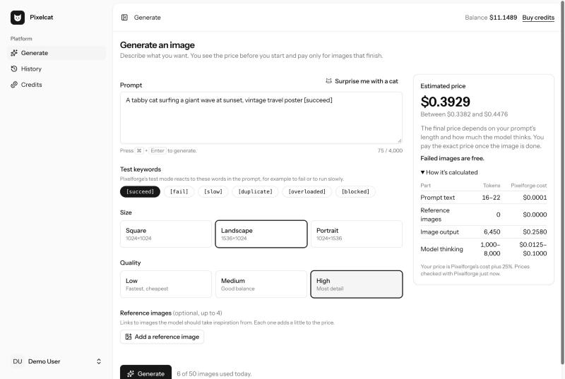
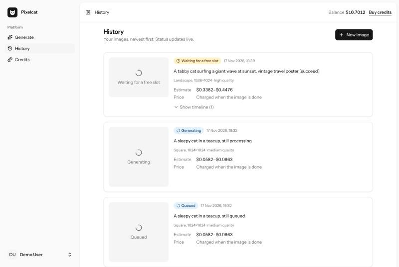
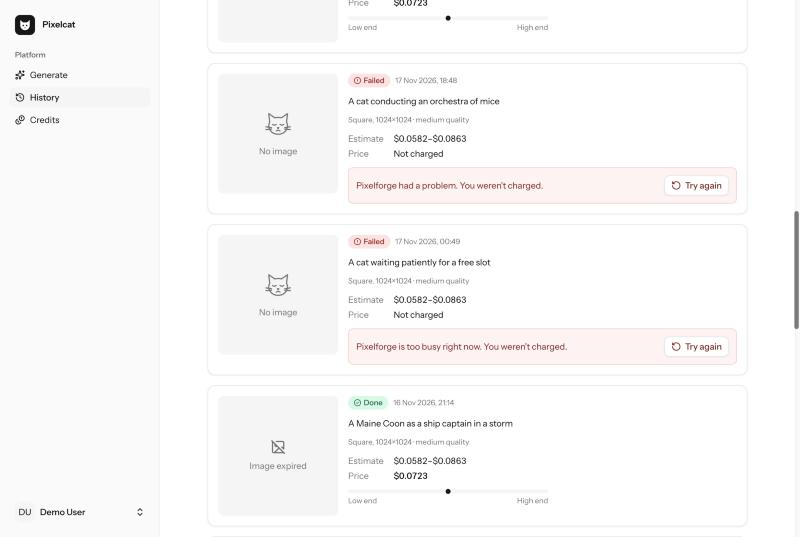
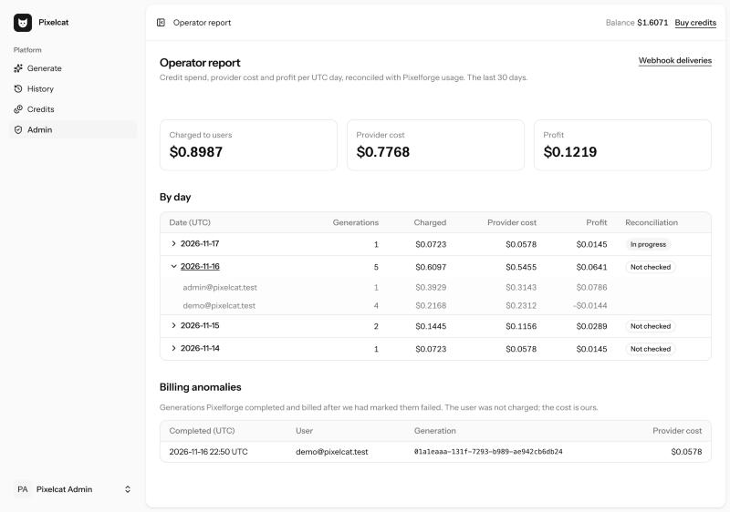
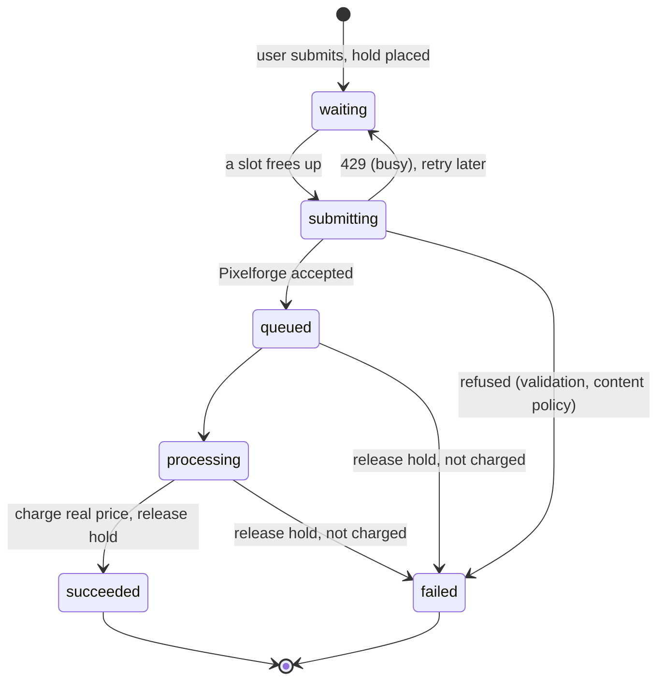
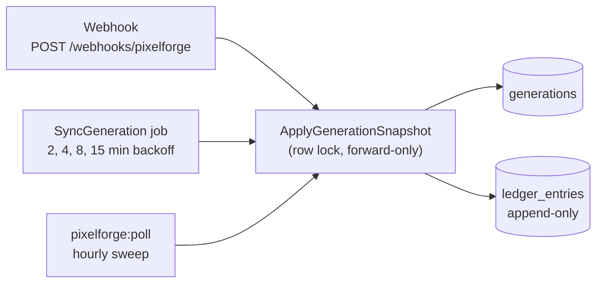
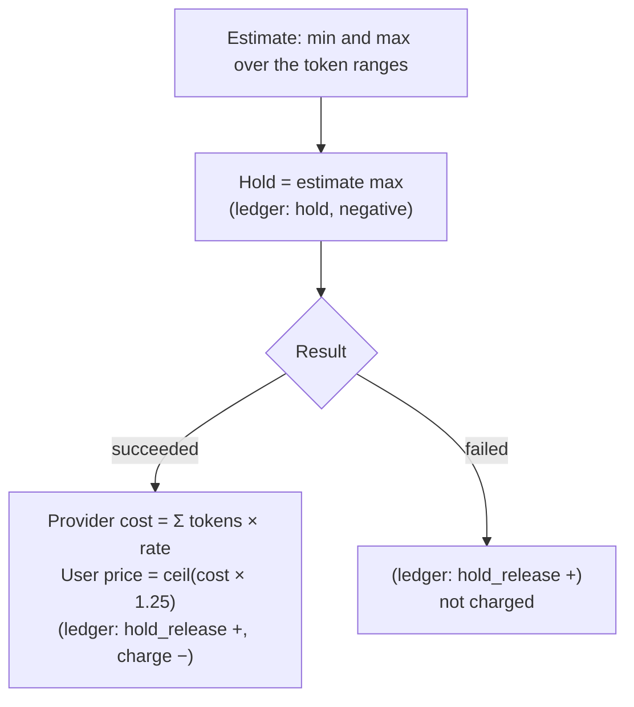

# Pixelcat

Generate images with the Pixelforge API and pay exactly what Pixelforge charged plus 25%.

**Live app:** https://pixelcat-production-xpvamo.laravel.cloud (demo and admin logins were sent
with the application).

Laravel 13, Inertia 3, Vue 3 + TypeScript, Tailwind 4, Postgres, Pest. Hosted on Laravel Cloud.

| Generate | History, live | History, finished |
|---|---|---|
|  |  |  |



## What it does

- **Estimate before you pay.** The form shows a price range for the prompt, size and quality,
  from the current Pixelforge pricing. The final price always lands inside the range.
- **Charge what Pixelforge charged, plus 25%.** The price is computed from the real token counts
  in the result, never from the estimate. Failed and blocked images are free.
- **Live history.** Each image moves through `waiting → submitting → queued → processing →
  succeeded | failed`, with a timeline of every event Pixelforge sent.
- **Signed webhooks, safe against duplicates and reordering.** Each event is applied once; an
  older snapshot never moves a generation backwards.
- **Fair use of a shared account.** At most 3 images in flight for the whole app, 2 per user, 50
  per user per day. The rest wait for a free slot, oldest first.
- **Credits.** New users get a welcome credit and can top up with a fake "Buy credits" button.
  Submitting holds the estimate's maximum; finishing releases the hold and charges the real price.
- **Operator report** (admins only): daily provider cost and revenue, reconciled against
  Pixelforge's `GET /v1/usage`, plus a webhook delivery log.

## How it works

### Generation lifecycle



`waiting` and `submitting` are ours; the rest mirror Pixelforge. A create whose response was
lost (timeout, 5xx) is **ambiguous**: it is retried with the same `Idempotency-Key` (the
generation's UUID) and never failed locally, because Pixelforge may already be drawing it.

### One writer



Webhooks, polling and replay all hand a Pixelforge snapshot to `ApplyGenerationSnapshot`, which
locks the row, applies only forward moves, and writes the charge or the release in the same
transaction. Webhook events are deduplicated by event id before they reach it.

### Money flow



- Money is integer **nanodollars** (`bigint`, 1 USD = 1,000,000,000) with `brick/math`, so a
  price like $0.067378125 is stored exactly. The UI shows 4 decimals and the exact value on hover.
- The 25% markup rounds **up** once, in `CalculateCost`; nothing else rounds.
- The ledger is append-only and the database enforces it: a trigger refuses updates, check
  constraints fix the sign of each entry type, and a generation has at most one hold, release
  and charge. Entries are deleted only with their user's account.
- Daily reconciliation (`pixelforge:reconcile`, 00:15 UTC) compares recorded provider cost with
  `GET /v1/usage` per day; the admin report shows `match` or the difference. To check the day in
  progress (for example right after a deploy), `php artisan pixelforge:reconcile --today` also
  shows today so far without storing it.

The reasons behind these choices (nanodollars, rounding up, applying webhooks in the request,
slot fairness, the ambiguity rule and more) are in [DECISIONS.md](DECISIONS.md). The full spec,
plan, data model and contracts are in [specs/001-image-generation](specs/001-image-generation).

## Run it locally

Needs PHP 8.3+, Composer, Node 22+ and Postgres 16+ with two databases, `pixelforge` and
`pixelforge_test`.

```bash
composer install && npm install
cp .env.example .env && php artisan key:generate
```

In `.env`, set the `DB_*` values, `ADMIN_PASSWORD`, `DEMO_USER_PASSWORD`, and switch to the
built-in fake Pixelforge (no account needed):

```dotenv
PIXELFORGE_FAKE=true
PIXELFORGE_BASE_URL=http://127.0.0.1:8001/_fake/pixelforge/v1
```

`php artisan serve` handles one request at a time, so the fake runs on a second server; otherwise
the app would wait on itself.

```bash
php artisan migrate --seed       # admin@pixelcat.test, demo@pixelcat.test, sample history
composer run dev                 # app on :8000, queue worker, scheduler, Vite
php artisan serve --port=8001    # the fake Pixelforge, in a second terminal
```

The fake understands the same test keywords as the real API: `[succeed]`, `[fail]`,
`[blocked]`, `[duplicate]`, `[slow]`, `[overloaded]`. To submit one of each for the demo user:

```bash
php artisan pixelcat:demo-generations
```

## Tests and checks

```bash
php artisan test                                  # Pest, against pixelforge_test
vendor/bin/pint --test
vendor/bin/phpstan analyse --memory-limit=1G      # level 8
npm run check && npm run types:check
```

The tests never call the real API (`Http::preventStrayRequests()`). Highlights:

- the worked example from the brief, to the nanodollar;
- the estimate range contains the actual price over 1,000 random token counts;
- duplicate, concurrent and out-of-order webhooks charge once (real Postgres row locks);
- the ledger trigger and constraints reject updates and double charges;
- slot fairness under concurrent dispatchers.

## Deploy

Every push to `main` runs CI (lint, types, Pint, Larastan, Pest on Postgres, dependency audits,
gitleaks over the full history). When it is green, CI calls the Laravel Cloud deploy hook and runs
a smoke test against the live app.

Laravel Cloud: a Flex 512 MB app that scales to zero, with the scheduler, a managed queue,
Serverless Postgres, and a private bucket for images. The production Pixelforge key's webhook
points at `/webhooks/pixelforge`.
